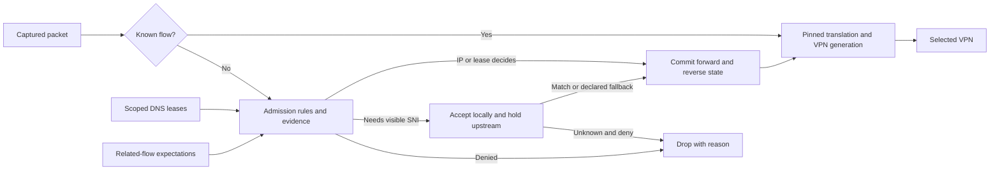

# Multi-VPN routing language

Open the self-contained HTML guide to edit policies, run typed event handlers, inspect branch traces and follow related connections. Its event reference identifies the hooks available on the shared multi-provider router and those demonstrated with fixtures. [Interactive routing atlas](RoutingAtlas.html#rich-playground)

The destination and source policy checker uses symbolic aliases. The live composition editor binds signed apps or temporary process instances on this Mac. The shared router can observe DNS replies and visible TLS ClientHello names, and Proxy Tunnel can select a configured numeric backend from a visible name. Full TLS termination and FTP related-flow helpers appear as simulations in the atlas. [Live routing](RoutingEvidence.md#app-and-running-process-routing-in-simplevpn)

The project owns the rule grammar, compiler and bytecode interpreter. The typed handler syntax resembles Rust’s `fn` and `match` and Swift’s `let` and `var`. Its event subscriptions resemble F5 iRules and Zeek. Rust executes live packet handlers. The offline atlas runs the portable Go reference evaluator as WebAssembly. JavaScript provides the interface and design replays.

## Layered events and objects

An event identifies what an adapter has just observed. A field identifies what that adapter knows at that moment. Add a more specific subscription when a parser recognizes a distinct operation. Keep negotiated settings and endpoint roles as properties of the observation. An event name prefix alone cannot authorize a parser, populate fields or dispatch a child hook. A single outbound TCP payload can pass the shared router’s IP, address-family and TCP handlers in order. When it contains a complete visible ClientHello, the TLS classifier can also dispatch a handler. A packet-level rule cannot assume that a TCP segment contains a whole application message.

A decoded FTP control stream uses the same events for cleartext FTP and FTP carried over TLS. An owned endpoint can expose transport endpoints, FTP state and TLS properties together. Reading unavailable evidence raises an error. A rule can check the supplied control-protection flag before reading TLS fields. Protection on the control connection and negotiated protection on a future data connection are independent.

| Observation | Dispatch | Available decision |
| --- | --- | --- |
| A complete client command | `ftp.command` | Inspect the verb and control context. |
| That command is PASV or EPSV | `ftp.command.passive` after the general handler | Inspect or decline the request. The data port is still unknown. |
| The server sends a complete reply | `ftp.reply` | Inspect the numeric reply. |
| The endpoint validates the negotiated data endpoint | `ftp.data_offer` | Request a scoped, expiring expectation. A passive 227/229 offer and an active PORT/EPRT offer have different directions. |

A drop or error ends dispatch for the current observation. The playground counts the handlers that entered and shows their order on the packet diagram. A rule saved with the older `ftps.handshake` spelling retains its FTP-specific scope. New rules subscribe to `tls.negotiated` and inspect `tls.application_protocol` when the owning endpoint supplies it. [Try the layered FTP examples](RoutingAtlas.html#protocol-layers)

## Multiplexed connections and messages

A transport flow can carry many independent requests. The shared packet router pins the flow to a VPN member and generation. Per-request backend selection needs an HTTP gateway that owns the client session, decodes the request, authorizes its authority and opens or reuses a compatible upstream connection. Record a separate binding for each pair of frontend and backend streams. Stream IDs have meaning within their own connections.

For HTTP/2, feed the ordered byte stream through HTTP framing and a per-direction HPACK decoder. For HTTP/3, the QUIC endpoint reassembles ordered bytes separately for each stream and the HTTP receiver resolves QPACK dependencies before publishing headers. An ACK, a decoded header block, an HTTP message end and a successful RPC completion are four different observations. Initial fields, informational responses, final fields, incremental body data, trailers and aborts each have their own phase. A WebSocket message, gRPC envelope or HTTP Datagram can introduce an additional unit of work on the same request.

The atlas compares blocked and canceled streams, tracks object ownership and commit points, and includes a gRPC framing exercise with split deliveries, empty messages, truncation and error trailers. These are designs for endpoint adapters. Current catalog and adapter availability remain in the event reference. [Multiplexed HTTP and QUIC](RoutingAtlas.html#multiplexed-messages) · [Common protocol design directory](RoutingAtlas.html#protocol-design)

## When the laptop is the server

Keep the TCP initiator, the FTP control client, the laptop and the authenticated VPN member distinct. For passive FTP presented on the Mac, the VPN peer initiates both the control and data connections. The server’s reply leaves the laptop on the same control connection. For active FTP, the FTP server initiates the related data connection back to the client. On that new TCP connection the transport roles reverse.

The shared multi-provider router delivers authenticated return traffic through a reverse binding keyed by tuple, member and member generation. A new remotely initiated flow has no such binding. Standalone WireGuard can deliver inner IP packets to a local listening service when peer authorization, host routes and firewall permit. An SSH reverse forward uses a listener on the SSH server, a channel over the established SSH transport, and a new local TCP connection.

The atlas also models a prospective inbound service policy. It admits a named service on an explicitly selected tunnel and tests the first packet separately from a return packet or related flow. The service model runs offline. [Compare incoming service paths](RoutingAtlas.html#inbound-service)

## Source identity and explicit lookup results

A persistent process rule selects a signed executable and can also require its exact filename, absolute path, a verified same-user ancestor executable, and a credential-free HTTP proxy endpoint. The helper uses the audit token to verify the process instance. `HTTP_PROXY` and `http_proxy` are distinct launch variables. The helper returns an explicit unavailable verdict when the OS withholds the value. The packet router receives the admitted source-rule ID. The atlas starts with a curl-in-Terminal rule on `socket.open`. It fires when a TCP connect, UDP connect, or first UDP send to a new peer gives an outbound flow a destination. The fixture supplies the caller as process context and records the actual remote endpoint separately from the configured proxy.

Use an exhaustive match to consume a typed table lookup. Empty strings, zero, false and empty buffers can all be present. A miss executes its own branch. Unavailable input evidence and invalid table data report errors.

```text
table sites: dns -> string = external "services";
on select: proxy.pre_connect {
  match lookup(sites, tls.sni) {
    found(member) { proxy.select_backend(member); }
    missing { drop(); }
  }
}
```

## Try the destination language

```text
policy 1
rule payroll ip 10.42.8.19 via finance
rule office ip 10.42.0.0/16 via work
rule office6 ip 2001:db8:42::/48 via work
default drop
```

```sh
cd Vendor/proxy-engine/src
go run ./cmd/routecheck ./cmd/routecheck/testdata/two-vpns.route 10.42.8.19 10.42.8.20 203.0.113.7
```

The three decisions are **finance** (payroll), **work** (office), and **drop** (default). Each result includes its source line. Omit the test addresses to print the normalized program. The native editor uses the same tool. VPN names in this prototype are symbolic. A preview proves a match for the supplied address. Applying it to an actual composition will also require binding the aliases, checking member capabilities and installing capture. [Example policy](../Vendor/proxy-engine/src/cmd/routecheck/testdata/two-vpns.route) · [Editor design and launch instructions](RoutingEditor.md)

### Executable grammar

```ebnf
policy       = "policy" "1" EOL { rule EOL } "default" action [ EOL ]
rule         = "rule" identifier ( "ip" destination | source [ "ip" destination ] ) action
source       = "app" "signed" identifier | "process" identifier
destination  = IPv4-address | IPv6-address | canonical-CIDR
action       = "via" identifier | "drop"
identifier   = ASCII-letter { ASCII-letter | digit | "_" | "-" }
```

Statements occupy one line. Whitespace separates tokens. Blank lines and comments from `#` to end of line are ignored. Identifiers are case-sensitive and at most 80 bytes. Rule IDs are unique and `default` is reserved as a rule ID. Bare addresses denote host prefixes. The checker rejects CIDRs with host bits set, mapped IPv6 addresses, scoped literals, unknown commands and trailing statements. It caps the source at 256 KiB and 4,096 explicit rules. This declarative fragment does no Tcl substitution. A draft can contain incomplete text while editing. Only a complete program is eligible for validation and preview.

**Order has meaning.** The first matching explicit rule wins. For single IP predicates, two prefixes of the same family are disjoint, equal, or nested. If a broader rule precedes a narrower one, the checker reports the earlier rule and the line to change. After this check, longest-prefix lookup gives the same answer as ordered evaluation. Several narrower rules can collectively cover a later broad rule. That case still evaluates correctly and is a useful future lint. The winning rule ID survives compilation, so the editor can explain the result without reinterpreting source.

### Test an application policy

```text
policy 1
rule office-host app signed browser ip 10.42.8.19 via finance
rule browser-default app signed browser via work
rule one-build process build-job via lab
default drop
```

Use `routecheck --app browser POLICY 10.42.8.19` or select **Signed app** in the offline editor and enter `browser`. Use `--process build-job` to supply a process alias. A source policy ends in `default drop` and uses source predicates on its explicit rules. Omit the source to test missing attribution. A destination qualifier on a source rule refines its VPN choice. In the live editor a bare address becomes a host prefix and the most specific matching override wins. To express that order in text, put the narrower prefixes first and the source's unrestricted rule last. The offline file does not install an app capture rule. The live GUI records executable signing requirements and member IDs rather than names from a draft.

### Binding and live precedence

A saved policy should store source, format version and an alias-to-profile-ID binding alongside the composition. The editor displays the current friendly name. Renaming a VPN preserves the binding. Deleting or importing it onto another Mac requires rebinding before Apply. A script cannot expand a WireGuard peer's AllowedIPs or give another engine a new transport capability.

For a **new** flow, resolve in this order:

1. Validate capture and packet ownership. Handle carrier sockets, resolver bootstrap and other protected control traffic according to their explicitly assigned paths. A rule may never route its own encapsulating transport back into itself. Verify inbound reverse state before accepting a reply.
2. Honor an existing flow decision. Synthetic aliases and related-flow expectations constrain the egress of a new flow. Intersect those constraints with managed policy, current authorization and explicit drops. Conflicting constraints produce a reasoned drop. An explicit rule cannot use a finance alias to reach the same numeric address in work.
3. Evaluate explicit user rules in order. The destination-only subset lowers to the shared prefix index. Later mixed predicates retain their source order even if indexed by different keys. A matched but unavailable target has a terminal failure disposition, initially drop.
4. Use VPN-advertised claims by longest prefix, with documented composition order for equal claims. A stopped member keeps its private claim until the configuration explicitly withdraws it. Then apply the configured default for that family. Once a default is selected for a flow, its failure follows the same target-failure rule.

The prototype has explicit rules and a default. The live compiler must build distinct explicit and advertised indexes so a more-specific advertised subnet cannot undo a user's broader override. Direct means the OS can route outside the composition and requires a concrete capture exclusion or supported direct transport. An empty port in a captured packet path cannot implement Direct. Model the IPv4 and IPv6 default capture and disposition independently, including paired /1s, an unsupported family and a deliberate block. The current wire format has one default owner. An unrepresentable plan must be refused. [Current wire contract](../Shared/VirtualRoutingConfig.swift) · [Previous architecture decisions](NetworkArchitectureReview.md#routing-and-failure-semantics)

A live `default drop` covering the whole Mac needs acknowledged capture for both defaults, subject to documented OS and transport exclusions. A policy attached only to selected subnets can promise a default inside those subnets. Preview and Apply must name that scope explicitly. Neither arrangement alone guarantees blocking after the extension crashes.

## Select a tailnet exit node

Use the SimpleVPN menu bar’s **Exit Nodes** section to switch an individual Tailscale or Headscale VPN live. For rule-based selection, configure the exit node on a member of a routed composition. If you want two exits available at the same time, use separate member profiles, each with its own node identity and saved exit choice. Use the exit node’s stable ID from the menu or its tailnet administration page.

```text
on https_via_exit: route.select {
    if port.dst == 443 {
        route.exit_node("nStableNodeID");
    }
}
```

`route.select` runs before the packet hooks on a new outbound flow in a shared composition. The destination must already have a permitted route. The action then selects a connected member that can reach the destination through that exit node. An unknown, unavailable or ambiguous selection drops the matching flow. Source-based routing still enforces the app’s authorized member. Existing flows keep their egress. The shared router sets `flow.has_exit_node` when the selected exit carries the destination. Read `flow.exit_node` only when that flag is true. A more-specific tailnet or subnet route can use the same member without using its internet exit.

## How names and related sessions fit the language

These examples propose **future syntax**. The current checker rejects them. Keep the small predicate/action grammar for common rules and reserve executable code for events that actually need state.

```text
dns finance-zone suffix finance.example.test resolve via finance answer synthetic
rule finance-name alias finance-zone via finance
rule named-api tls.sni api.example.test tcp 443 via work on-unknown drop
```

Here `finance-zone` would bind the query rule, resolver and address lease. The DNS rule needs a concrete resolver reachable through finance. The TLS rule needs a locally accepted TCP stream whose upstream connection is still unopened. Their runtime requirements differ even though they share a target. The editor should say exactly which requirement is missing.

Give each fact a type, provenance, capture point, freshness and earliest availability. A predicate can match, fail to match, or remain unknown. Combine predicates with typed conjunction first. Introduce alternation only when needed. An unknown capable of changing a protected decision requires an explicit unknown branch. Supported options can include a bounded wait on an eligible stream, a named authorized alternative or drop. Unavailable egress is a distinct condition. An ordinary IP rule never waits for DNS or TLS. If SNI arrives after a raw TCP SYN has left, it can add evidence to the existing decision but cannot move the connection.

**Overlapping destinations.** Suppose work and finance both have a `10.42.8.19` and an internal DNS server at the same address. Resolve each name in its selected VPN's resolver context. Publish a distinct synthetic address to each client only after the capture owner has acknowledged its mapping. On first use, pin the alias, real address and VPN generation. Rewrite the synthetic destination to the real address and masquerade the source as that VPN's assigned address. The reverse mapping restores the synthetic address that the application connected to. An unrelated direct-IP connection to `10.42.8.19` still follows its explicit IP policy. A lookup through the system resolver, a DNS reply and a later connection from a sibling process are three different observations. Keep all viable candidates and their expiry. An inferred name can label a flow. Moving private traffic to a different VPN requires authoritative evidence or an explicit IP rule. [DNS, SNI, app metadata and acceptance scenarios](RoutingEvidence.md)

### Worked packet trace

Consider the following replay fixture. Both VPNs assigned the client `10.0.0.2`. The test allocator reserved two example addresses, and the DNS answer for each private name happened to contain the same real server. This table uses documentation addresses for clarity. A deployed pool requires collision checks.

| DNS answer delivered to client | Client socket before translation | Packet on chosen VPN | Reply delivered to client |
| --- | --- | --- | --- |
| `db.work.example.test → 192.0.2.40` | `198.19.255.1:51000 → 192.0.2.40:5432` | work generation 7, `10.0.0.2:51000 → 10.42.8.19:5432` | `192.0.2.40:5432 → 198.19.255.1:51000` |
| `db.finance.example.test → 192.0.2.41` | `198.19.255.1:51000 → 192.0.2.41:5432` | finance generation 3, `10.0.0.2:51000 → 10.42.8.19:5432` | `192.0.2.41:5432 → 198.19.255.1:51000` |

The VPN ID and generation resolve identical wire tuples on different egresses. If both leases instead select the *same* egress and real endpoint, the second flow needs a distinct translated source port. A late reply for finance generation 3 must be discarded after generation 4 takes over.

### Events and executable hooks

Keep the existing proposal for Tcl 9 handlers behind an opt-in capability. The compiler emits native decisions for ordinary rules. A handler receives an immutable event view and can return a small set of typed effects valid for that phase. Ship normalized protocol parsers separately and expose their fields, so a user can connect two sessions without writing a TCP reassembler. A bounded parser extension can later emit the same events, after validation of its inputs and resource limits. [Tcl event vocabulary](PolicyEvents.md)

| Event | Available facts | Permitted effect |
| --- | --- | --- |
| DNS request / validated answer | Listener, original resolver, normalized question, scoped answer chain | Select an authorized resolver, mint a scoped lease, or return a defined failure |
| Flow admission | Original tuple, interface and generation, admitted alias, delivered app identity, related expectation | Commit an egress, block, or reserve a bounded pre-connect classifier |
| ClientHello available | Bounded handshake facts and whether upstream has committed | Choose among preauthorized egresses before upstream commit. Otherwise annotate or close |
| Protocol negotiation | Confirmed parent flow, direction, parsed operation and negotiated endpoints | Declare a short-lived expectation for a child of this parent |
| Flow close / VPN generation retired | Connection ID, reason, timestamps, outstanding expectations | Release reservations, remove expectations, update bounded counters |
| VPN requested | Policy ID, granted profile alias and request token | Enqueue an idempotent app-side connect request, coalesced by profile. Expose completion asynchronously |

For example, this **proposed handler** links a passive FTP data flow to its control connection:

```tcl
when FTP_TRANSFER_OFFER {
    if {[FTP::mode] eq "passive"} {
        RELATED::expect -parent [FLOW::id] -protocol tcp \
            -direction outbound -peer [FLOW::remote_address] \
            -port [FTP::data_port] -egress inherit -uses 1 -ttl 15s
    }
}
```

The expectation is a reservation for a matching flow. Creating it sends no packet and opens no listener. The router checks the authenticated member generation, parent state, endpoint limits and grants before installing it. An ambiguous match cannot choose a tenant. An explicit managed deny or administrator revocation wins. Hooks cannot read VPN credentials or create arbitrary network sockets. Normalize name and address values once. Bound queued events, per-handler CPU/commands, memory, reassembly bytes and wall time. Execute outside the packet-table lock. Commit effects atomically only while the parent and policy are still valid. On timeout or error discard the effects and follow the rule's declared failure path.

Bringing up the VPN itself is a different event. For example, a control-plane `when POLICY_INIT { VPN::require finance }` requests an existing profile through the app's normal connection and authentication path. A hundred waiting flows share one pending request for that profile. A callback identifies the request and session generation, so a completion after cancellation cannot release traffic on the wrong VPN. Waiting has a byte budget and deadline. VPN carrier and resolver bootstrap dependencies must be acyclic. A policy that needs finance DNS to resolve finance's only transport endpoint needs an independent bootstrap path.

**Active FTP.** The data connection arrives from the server, the opposite direction to passive FTP. Supporting it requires a member which can accept that inbound flow, an allocated translated endpoint, and reversible expectation state. Constrain PORT/EPRT to the authenticated control client's permitted endpoint and PASV/EPSV to the control peer or a separately declared peer set. Never grant a general inbound port from the text of a control message. If an address or port advertised inside the control stream must change, use a local protocol-aware stream relay capable of correct retransmission and length changes. An encrypted FTPS control channel provides no plaintext offer. Show that the helper has no observation.

**SIP and media.** Early media, separate RTP and RTCP, multiplexed media, renegotiation and forking can associate several child flows with one control session. Correlate a dialog by its scoped call ID and local/remote tags, include transaction sequence and SDP media generation, and install expiring, directional expectations for the negotiated candidates. A call ID alone is insufficient. Re-INVITE replaces a generation. BYE, timeout and member loss retire expectations. ICE can select a different candidate pair or a TURN relay. Do not open every address offered in SDP. Require a verified pair within the permitted peer set or keep the original flow policy. TLS-encrypted SIP hides SDP. SRTP does not imply an observable signaling channel. FTP and SIP need separate protocol acceptance suites before either helper can grant child flows.

## Execution targets and adapter validation

The bundled checker type-checks source against the event and field capabilities of the selected adapter. It validates all function bodies, expands nonrecursive calls and produces a typed control-flow graph. Rust independently verifies stack types, operand access, local initialization, effects and branch destinations. A missing observation, invalid edit or exhausted budget fails the event and discards staged packet edits.

Edited numeric handlers compile at activation to an immutable register program. Its SSA builder merges incoming values with phi arguments, propagates constants along executable edges, reuses dominating expressions and removes unused pure computations. Reads that can fail, checked arithmetic and writes remain observable. An unusually short remaining instruction budget uses the original verified instruction locations for precise accounting. For network values, arrays, loops and table lookups the runtime binds verified operations to signed Rust primitives at activation. The hot path never parses a source file or invokes an external compiler.

A release can compile any verified typed handler to target-native code with LLVM. The compiler emits native control flow for loops, lookup arms and short-circuit expressions. Numeric policies use unboxed scalar operations. The signed archive selects a generated kernel only for its exact handler image. Other source edits use the activation-time backend and need no toolchain on the user’s Mac. The build includes examples for SSH channel admission, DSCP arithmetic and inbound prefix-table lookup with a user function and loop.

```sh
checker="build/review-derived-data/Build/Products/Release/SimpleVPN.app/Contents/Helpers/routecheck"
"$checker" --emit-llvm openvpn3 priority Vendor/routing-core/policies/dscp.route > priority.ll
xcrun clang -O2 -c priority.ll -o priority.o
```

To include a policy in a signed build, create a directory for the release’s additional images, write the output of `routecheck --emit-handler ADAPTER HANDLER SOURCE` to a file with the extension `.rcr`, and set `SIMPLEVPN_AOT_DIR` to that directory when building. The build verifies every image before generating machine code and links the resulting objects into the runtime. `SIMPLEVPN_LLVM_OPT` can name a separate LLVM installation’s `opt` executable to run SROA, mem2reg, SCCP, GVN, ADCE and SimplifyCFG explicitly before machine-code generation. That installation must also provide its matching `clang`.

List the installed adapter definitions with `routecheck --adapters`. Use `routecheck --events-for wireguard-shared HANDLERS` to target a live attachment. Each mode declares its saved profile kinds, ownership boundary, availability and whether it can execute those packet handlers. The existing `--events` flag selects the same shared routing grammar. The browser supports additional offline fixtures. Policy changes and restores must validate against the mode that will actually run, including any planned fallback. [Adapter matrix](RoutingAtlas.html#rich-adapter-reference)

## Compiled program and connection state



The editor keeps a lossless source tree with byte spans and comments. The live compiler resolves aliases against a snapshot, checks capability, stage, effects, resource bounds and bootstrap cycles, and emits a versioned, immutable program with stable rule IDs and a source map. The provider revalidates the IR against the actual members before use. Source, display names and Tcl are absent from the established-packet lookup.

| Table | Key | Value and lifetime |
| --- | --- | --- |
| Explicit IP and advertised routes | Family, canonical prefix | Rule ID or member ID, terminal action, policy revision. Immutable per program. |
| General admission rules | Stage plus indexed candidate predicates | Ordered rule IDs, required fact/effect masks and bounded decision instructions. Evaluate only until a disposition is known. |
| Forward flow | Capture domain, family, protocol, original tuple | Connection ID, winning rule and revision, member and generation, original/translated tuples, state, deadlines and optional evidence IDs. |
| Reverse flow | Member and generation, protocol, translated reverse tuple | Same connection ID, with inverse translation for return packets and quoted ICMP. |
| DNS evidence / synthetic lease | Resolver and listener scope, network generation, requested name/type, client scope where proven | Answer RRset, aliases, TTLs, provenance. Leases also hold synthetic/real mapping and references from active flows. |
| Related-flow expectations | Parent connection and protocol generation, direction, permissible peer/port range | Pinned target, expiry, use count and narrow grant. Claim once atomically. Bound per parent, tenant and globally. |

The existing Go fast path already indexes exact forward/reverse tuples and pins the port generation. It drops reverse-tuple collisions today. A DNAT implementation must also handle two aliases pointing to the same real endpoint using the same client source port. Allocate an available translated port or ICMP identifier with bounded attempts, maintain both directions atomically, and fail closed on exhaustion. Keep established mappings through DNS TTL expiry. A fresh TCP SYN with a new incarnation, UDP association expiry, port reuse and a late reply from a retired generation must have distinct outcomes. ICMP errors carry quoted inner packets. Translate those too, including MTU feedback. Reassemble fragments within existing bounds before making a first-flow decision. [Packet router](../Vendor/proxy-engine/src/packetrouter/router.go) · [Fragment ownership](../Vendor/proxy-engine/src/packetrouter/fragments.go)

The current implementation caches established flow decisions. A new flow uses a compact stable list for up to eight destination rules. Larger sets probe only the prefix lengths present for the address family, with at most 33 IPv4 or 129 IPv6 prefix widths. Equal claims retain their first owner. For future multi-predicate rules, index selective fields to produce candidates and resolve original rule ordinals across indexes. DNS facts, SNI and verified identity are distinct predicates. Compile term/action types and jumps ahead of time. Validate instruction counts, jump targets, section lengths, revision and program version on the receiving side. Allocate optional DNS and parser state only when an active rule needs it. Keep policy revisions alive only as long as pinned flows or traces reference the needed metadata, with bounded retention. Persist aggregate counters by default. Detailed evidence is scoped, expiring and on demand.

**Applying a revision.** Compute capture ranges and forwarding actions from one bound plan. Preflight against the last acknowledged revision. Fence new flows for affected ranges before a capture expansion could expose them to the old default. Install the OS settings, publish the prepared program on acknowledgement, then release the fence. Preserve established decisions unless explicitly revoked. On rejection keep or restore confirmed settings and program. A timeout with uncertain OS state must retain the fence or terminate the capture session. On a split-tunnel change, traffic outside the old capture may still be OS-routed before the expansion is acknowledged. The UI must report that boundary. A provider crash also has different guarantees from a missing egress in a running provider.

### What was measured

On the development Mac, the isolated IPv4 destination lookup with 4,096 /24 rules took about 11 ns per lookup, compared with 5.9 µs for the old scan. The test cycles through an early match, a middle match, a late match and a miss. Both versions allocated zero bytes per lookup. With four rules the compact path and the original scan were both around 9 ns. Mixed prefix widths require additional probes.

The next bottleneck was a separate scan of a WireGuard port's AllowedIPs. In a synthetic TCP admission benchmark with 4,096 route rules and 4,096 authorized hosts, indexing that check reduced first-packet processing from 14.4 µs to 0.304 µs, with two allocations per new flow. The single-authorized-subnet control measured 0.291 µs before and 0.288 µs after. The production router processed the SYNs and selected a mock egress. These timings exclude encryption, network I/O, DNS and handshake inspection. Re-run from `Vendor/proxy-engine/src` with `go test -run '^$' -bench 'BenchmarkDestinationLookup|BenchmarkNewTCPFlowAllowedIPs' -benchmem -count=3 ./packetrouter`.

## Order of delivery

1. **Destination design workbench, this change.** Compile a source file, show winning rules against sample addresses, test the native editor, and compare indexed lookups with the previous scan. No VPN is required. On the existing virtual router, retain stopped-member private claims and exercise new and established connections after a policy refresh.
2. **First live milestone.** Bind IP rules to stable member IDs in one WireGuard composition. Add explicit block dispositions, per-family defaults and authorization, the transaction fence, and recorded rule IDs. Require a signed two-peer test with independent counters covering overlapping IPv4 and IPv6, a more-specific exception, endpoint bypass, target loss and reconnect, failed apply, and continued traffic while switching revisions. Neither a second peer nor the default may receive a packet addressed to a blocked private member.
3. **DNS and translation.** First release observational joins with a trace explaining ambiguity. Then add per-member resolver transport, committed synthetic leases, reversible DNAT/SNAT, address-pool and DNSSEC handling. Require two private zones resolving to the same address, delayed answers, IPv4/IPv6 races, alias exhaustion and no fallback to another resolver.
4. **Protocol evidence and helpers.** Add bounded pre-connect TCP classification and test fragmented ClientHello, absent SNI and ECH. Then implement the expectation API, one passive FTP fixture, active FTP with an inbound-capable egress, and SIP/ICE fixtures. Measure flows/s, tail admission latency, memory per pending classifier, deadline behavior under load and steady-state packet allocations.
5. **Installed app-routing acceptance.** The implementation uses per-app packet capture and a signed identity service. Validate real source metadata and egress on the target macOS build. Exercise helpers, a reused PID, cached/asynchronous DNS, unavailable identity, and an app that supplies its own DNS. Keep ancestry as evidence with explicit provenance. The GUI should offer an enforceable app rule only after an on-device test proves that flow metadata and routing work together.

The older policy and event documents remain useful for the broader Tcl vocabulary. This design narrows the first executable surface, fixes the commitment point for TCP, and records the actual WireGuard and DNS boundaries. [Earlier policy proposal](PolicyRouting.md) · [Evidence and acceptance cases](RoutingEvidence.md) · [macOS editor](RoutingEditor.md)
